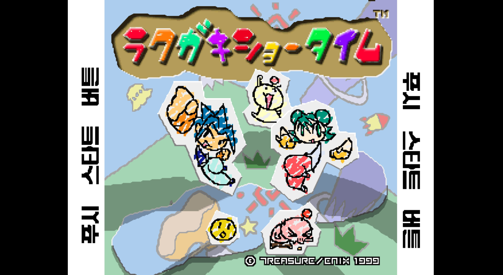

# 라쿠가키 쇼타임 — 플레이스테이션

플레이스테이션 **라쿠가키 쇼타임** 한글 번역 패치 프로젝트입니다. 낙서풍 캐릭터들이 대결하는 액션 게임입니다.

> **영상 7개 자막 통합 배포본 · 2026-08-11**

<!-- game-preview:start -->
개발용: [영상 통합 배포판 재빌드 안내](docs/REBUILD_2026-10-16.md). 보유한 원본·동일 글꼴·xdelta3로 치트판과 일반판을 재현한다.

  

**타이틀 · 한글 시작 안내** — 사용자 제공 라쿠가키 쇼타임 전체 타이틀 화면. 대형 로고는 원문이며 양옆 시작 안내는 한글입니다.
<!-- game-preview:end -->

## 다운로드 및 적용 방법

1. 아래 체크섬 또는 상세 안내와 일치하는 원본을 준비합니다.
2. [최종 배포 패치 다운로드](https://github.com/akuma815/ps1-rakugaki-showtime-kr-patch/releases/tag/movies-20260811)에서 ZIP을 받아 모두 압축 해제합니다.
3. 원작 진행을 유지하려면 `apply_no_cheat.cmd`, 자동 해금을 원하면 `apply_cheat.cmd`에 원본 BIN을 끌어다 놓습니다.
4. 생성된 CUE 파일을 에뮬레이터에서 엽니다.

## 주의사항

- 일본판 SLPM-86272의 단일 MODE2/2352 BIN 전용입니다.
- 자동 해금판과 원작 진행판 중 하나만 적용합니다.
- 일부 영상 자막은 초벌이며, 7개 영상 전체의 최종 런타임 검증은 미완료입니다.
- 원본 게임·BIOS 및 패치가 적용된 게임 이미지는 포함하지 않습니다.

## 체크섬

| 구분 | SHA-256 |
| --- | --- |
| 원본 | `99dc6c7f748c4882d6f197a0a0a2eb943affc25bb4271deff9bb9bf55859aa54` |
| 패치 파일 `Rakugaki_Showtime_KR_MOVIES_CHEAT_001.xdelta` | `ea571eb357e38058246abd5a70005a6c160a43adde3fc7ad4f6b3bcf951c3468` |
| 패치 파일 `Rakugaki_Showtime_KR_MOVIES_NO_CHEAT_001.xdelta` | `db3fdf143fc89711ff56eaeaa079e75dcfe73774e2f5d7e5763509c5d915e4df` |
| 패치 후 이미지 cheat | `95566062e4e3045f5c428ff9108e1b6f51338fe4daaaa7cfc2583ffc99eab7fa` |
| 패치 후 이미지 no_cheat | `7f9fa82274ed4985963b84ff9e5137e91fae354c7cacaf6fffa13101e0511fd7` |
| 배포 압축 파일 | `c93469b8d729634449b3b4be94b923177c9c0aebb7827942939442b31cba3052` |

## 소스 및 작업 기록

[공개 소스 구성과 빌드 전제](docs/SOURCE_GUIDE.md) · [상세 패치 안내](docs/PATCH_GUIDE.txt)
